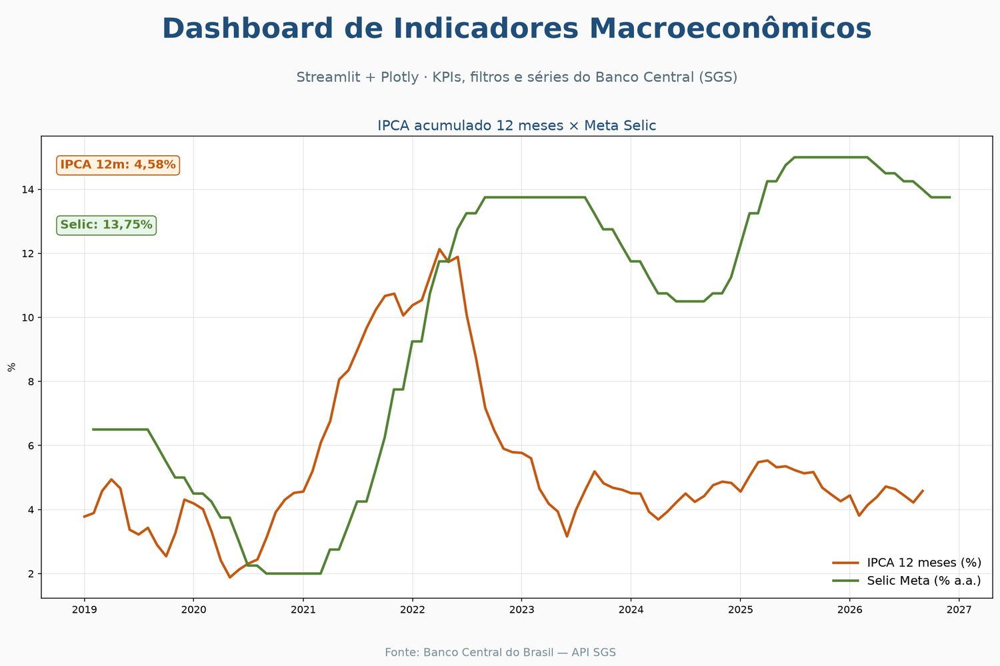

# Dashboard de Indicadores Macroeconômicos (Brasil)

Dashboard interativo (Streamlit + Plotly) com KPIs, filtros e gráficos sobre séries públicas do **Banco Central (SGS)**: IPCA, IPCA 12 meses, Selic Meta, USD/BRL e IGP-M.

Inclui também um HTML estático Plotly para portfólio/demo sem servidor.

## Objetivo

Apresentar indicadores claros para análise rápida — o mesmo tipo de entrega que um painel em Power BI faria para o negócio, aqui em Python para facilitar a reprodução pública.

## Fonte de dados

- API SGS/BCB: `https://api.bcb.gov.br/dados/serie/bcdata.sgs.{codigo}/dados?formato=json`
- Códigos: `433` (IPCA), `13522` (IPCA 12m), `432` (Selic Meta), `1` (USD PTAX), `189` (IGP-M)

## Stack

- Python, pandas, requests
- Streamlit (app interativo)
- Plotly (gráficos + HTML estático)

## Como rodar

```bash
python -m venv .venv
source .venv/bin/activate
pip install -r requirements.txt

# Baixa/atualiza o CSV local
python src/baixar_dados.py

# App interativo
streamlit run src/app.py

# HTML estático (sem servidor)
python src/gerar_html_estatico.py
# → output/dashboard_indicadores.html
```

## Guia: o mesmo modelo no Power BI

> **Nota honesta:** não é possível gerar um arquivo `.pbix` neste ambiente Linux. O caminho natural no Windows/Power BI Desktop seria:

1. **Obter dados** → Web / Power Query apontando para a API SGS (ou use o CSV `data/indicadores_bcb.csv` gerado aqui).
2. **Modelo**: tabela fato `observacoes` (data, valor, codigo_sgs) + dimensão `series` (nome, unidade). Relação `codigo_sgs`.
3. **Colunas**: `Ano = YEAR(data)`, `Mes = MONTH(data)`, `AnoMes`.
4. **Medidas DAX** (equivalentes aos KPIs do app):
   - `Ultimo Valor = CALCULATE(MAX(observacoes[valor]), LASTDATE(observacoes[data]))`
   - `Valor Anterior = CALCULATE([Ultimo Valor], DATEADD(calendario[data], -1, MONTH))`
   - `Variacao = [Ultimo Valor] - [Valor Anterior]`
5. **Visuais**: cartões para KPIs, linha para evolução, slicers de série e ano — espelhando o layout do Streamlit.
6. **Atualização**: agendar refresh no Power BI Service após publicar (gateway se a origem for arquivo local).

## Resultados

- KPIs com variação vs. observação anterior
- Filtros por série e período
- Comparativo IPCA 12m × Selic
- HTML estático em `output/dashboard_indicadores.html`



## Autor

João Vitor — Engenharia de Software (UEM). SQL, Python (ETL/automação) e Power BI.
